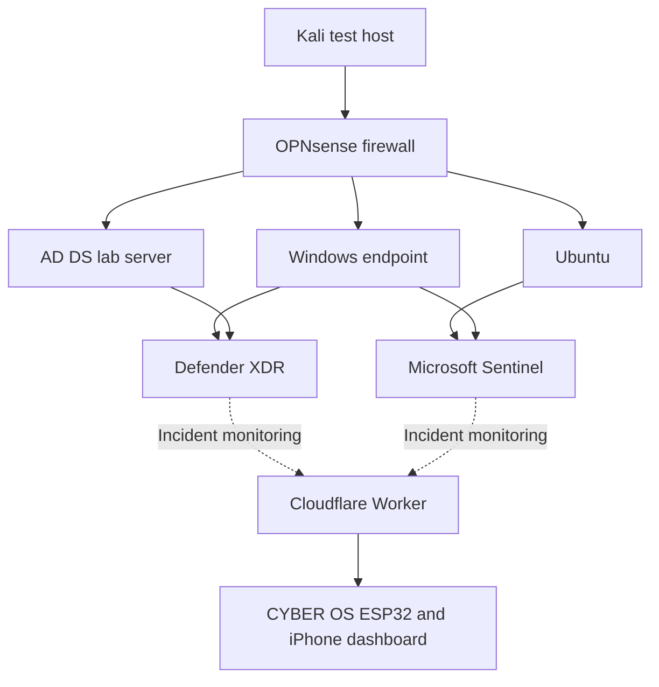

# Lab architecture

Logical architecture, not a verified physical wiring diagram. Individual integrations were exercised at different stages; simultaneous end-to-end operation is not asserted.

- Windows security events and Linux syslog collected through Azure Monitor Agent and data collection rules.
- Ubuntu onboarded to Azure Arc and Defender for Endpoint.
- Windows endpoint onboarded to Defender for Endpoint; ARM Sysmon driver limitation encountered.
- AD DS and DNS configured in a separate lab; Defender for Identity sensor reported healthy, with auditing advisories.
- CYBER OS project reported Sentinel/XDR monitoring through a Cloudflare Worker and iPhone interface.
